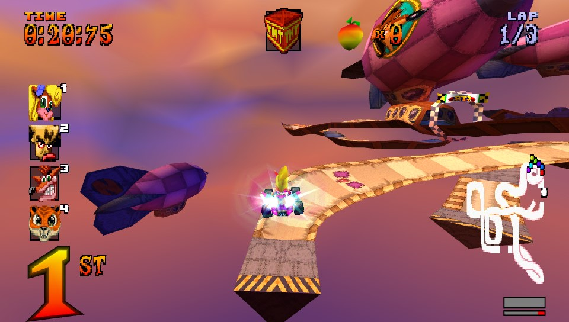

# Crash Team Racing: High Octane
</img><br>
Crash Team Racing: High Octane is a sourceport for PSVita, PC (Windows) and Web Browser of Crash Team Racing based on the [ctr-native](https://github.com/CTR-tools/ctr-native) project.
It focuses on new features, enhancements and optimization.

You can play it from Web Browser as well from this link: [Web Browser Build](https://rinnegatamante.github.io/Crash-Team-Racing-High-Octane/).

## Features

- True widescreen with no stretching.
- Internal resolution of the renderer bumped to 960x544.
- MSAA 4x (PSVita) / FXAA (PC) for anti-aliasing.
- 60 FPS support.
- Post-processing effects (CRT, Sepia, Greyscale, Negative, Sharp Bilinear, ...).
- Perspective correction via PGXP implementation derived from [Crash Team Racing: Turbocharged](https://github.com/CameronRedmore/Crash-Team-Racing-Turbocharged).
- Penta Penguin has its stats set to its PAL/NTSC-J counterpart (6/6/6).
- Playable Nitrous Oxide (Unlockable via the original Spyro 2 Demo cheatcode). (Credits: [Original mod](https://github.com/CTR-tools/CTR-ModSDK/tree/main/mods/Modules/OxideFix))
- Reserves Meter (Credits: [Original mod](https://github.com/CTR-tools/CTR-ModSDK/tree/main/mods/Modules/ReservesMeter))
- Customizable Cups (Credits: [Original mod](https://github.com/CTR-tools/CTR-ModSDK/tree/main/mods/Modules/CustomCups))
- Multilanguage support with (optional) PAL voiceovers support (Check "How to use PAL voiceovers").
- Super and Ultra Hard Difficulty modes for Arcade mode.
- USF will show as blue fire (similar to CTR: Nitro Fueled). (Credits: [Original mod](https://github.com/CTR-tools/CTR-ModSDK/tree/main/mods/Modules/BlueFire))
- Super turbopads are cyan to distinguish them from regular turbopads.
- Mirror mode option: Play any track specular.
- Boss Fight option: Challenge Adventure mode bossfights on any track.
- [PSVITA Only] AdHoc Netplay support for two PSVitas multiplayer without the need of a router.
- Several vanilla game bugfixes (eg: PVS related glitches and Penta-Penguin wrong mask powerup HUD icon).
- Ghost Replay feature: Replay all your ghost datas as if you're seeing the run being played live with inputs viewer overlay.
- Increased ghost data limits: No more 7 ghosts globally, now there are 7 ghosts data slot per track.
- Stats viewer for characters in the character selection screen.
- Online leaderboard for Time Trials and Relic Race results.
- Splitscreen support for up to 4 players local multiplayer for PC and PSTV users or PSVita users with MiniVitaTV.
- [PC Only] Discord Rich Presence support when playing with Discord opened.
- Reverse tracks mode for Crash Cove, Roo's Tubes, Tiger Temple, Coco Park, Dragon Mines, Tiny Arena, Slide Coliseum and Turbo Track available in Time Trial and Relic Race mode.
- Relic Race mode available outside of Adventure mode and accessible with any character.
- Relic Race mode now has ghosts support.
- Custom characters support with pre-baked animations option.
- Custom tracks and battle arenas support.
- Personal bests tracking during Time Trials.
- Alternative Temple Tiger variant for Time Trial and Relic Race.
- Fully rebindable controls.
- And many many more...

## Online leaderboard

The full online leaderboard for Time Trials and Relic Races is available at this link: <a href="https://www.rinnegatamante.eu/ctr/leaderboard/">Online Leaderboard</a>.

## Known Issues

- [PSVita Only] The demo cutscene gets slightly de-synced during Oxide speech.

## Special controls bindings

- [PC/Web Browser] F11 is a shortcut to swap between Windowed and Fullscreen Borderless mode.

## How to Install (PSVita)

- Install the .vpk.
- Dump your US copy of `Crash Team Racing` for PS1 and place the bin file in `ux0:data/ctr/assets` named as `ctr-u.bin`.

## How to Install (PC)

- Dump your US copy of `Crash Team Racing` for PS1 and place the bin file in the `assets` folder named as `ctr-u.bin`.

## How to use PAL voiceovers

- Install Python 3.11 or higher ([https://www.python.org/downloads/](https://www.python.org/downloads/)).
- Download [this script](https://github.com/Rinnegatamante/Crash-Team-Racing-High-Octane/raw/refs/heads/vita/tools/extract_pal_voices.py) by right-clicking the link and selecting "Save link as..." or, if the script opens in the browser, "Save page as...".
- Place your PAL Crash Team Racing `.bin` dump in the same folder as the script.
- Open a command prompt in that folder by typing `cmd` in the File Explorer address bar and pressing Enter.
- Run `python extract_pal_voices.py YOUR_DUMP_NAME.bin`.
- When extraction is complete, place the generated `pal-voices` folder:
  - on PSVita: in `ux0:data/ctr/mods/`.
  - on PC: in the `mods` folder next to the CTR: High Octane executable, so that the final path is `mods/pal-voices`.

## How to add new custom characters to the game

- Install Python 3.11 or higher ([https://www.python.org/downloads/](https://www.python.org/downloads/)).
- Download [this script](https://github.com/Rinnegatamante/Crash-Team-Racing-High-Octane/raw/refs/heads/vita/tools/import_custom_racer.py) by right-clicking the link and selecting "Save link as..." or, if the script opens in the browser, "Save page as...".
- Download [xdelta3](https://github.com/Rinnegatamante/Crash-Team-Racing-High-Octane/raw/refs/heads/vita/tools/xdelta3.exe) and place it in the same folder as the script.
Download a custom character in the form of an `.xdelta` patch and place it in the same folder as the script.
- Place your NTSC-U Crash Team Racing `.bin` dump in the same folder as the script.
- Open a command prompt in that folder by typing `cmd` in the File Explorer address bar and pressing Enter.
- Run `python import_custom_racer.py YOUR_DUMP_NAME.bin YOUR_PATCH.xdelta YOUR_CHARACTER.ctrr`.
- To customize the generated racer, append any of these optional arguments:

  | Option | Description |
  | --- | --- |
  | `--name "Racer Name"` | Set the in-game name. By default, the importer uses the patched character name when available. |
  | `--author "Author Name"` | Set the mod author's name. |
  | `--engine-class {-1,0,1,2,3}` | Override the racer's engine class with `0`–`3`. Omit this option (or use `-1`) to keep the replaced character's class. |
  | `--wheels {on,off}` | Force wheels to be shown or hidden. Omit this option to keep the replaced character's default. |
  | `--mask {aku,uka}` | Select the Aku Aku or Uka Uka mask. Omit this option to keep the replaced character's default. |
  | `--template-animations` | Retarget and bake the replaced character's animations onto a static custom model. Models that already contain animations are left unchanged. |
  | `--xdelta3 PATH` | Use a specific xdelta3 executable instead of the copy next to the script or one on PATH. |

  For example, to import a static model with its original character's animations, custom name and author, Uka Uka mask, and wheels disabled:

  ```sh
  python import_custom_racer.py YOUR_DUMP_NAME.bin YOUR_PATCH.xdelta YOUR_CHARACTER.ctrr --template-animations --name "My Racer" --author "Mod Author" --mask uka --wheels off
  ```

- If the patch replaces multiple characters, the importer automatically generates one `.ctrr` per changed racer, adding the original character name to the requested output filename (for example `YOUR_CHARACTER_crash.ctrr`, `YOUR_CHARACTER_cortex.ctrr`, etc.). You can also pass an output directory instead of a `.ctrr` filename for multi-character patches. Optional overrides apply to every generated racer.
- Changed XA voices and sampled voices from `KART.HWL` are extracted automatically when present in the patch; no extra command-line option is needed. Regenerate older `.ctrr` packs to include newly supported sampled voices.
- When conversion is complete, place the generated `.ctrr` file or files:
  - on PSVita: in `ux0:data/ctr/mods/customracers`.
  - on PC: in the `mods/customracers` folder next to the CTR: High Octane executable, so that the final path is `mods/customracers/YOUR_CHARACTER.ctrr`.

## How to add new custom tracks to the game

- Install Python 3.11 or higher ([https://www.python.org/downloads/](https://www.python.org/downloads/)).
- Download [this script](https://github.com/Rinnegatamante/Crash-Team-Racing-High-Octane/raw/refs/heads/vita/tools/import_custom_track.py) by right-clicking the link and selecting "Save link as..." or, if the script opens in the browser, "Save page as...".
- Download [xdelta3](https://github.com/Rinnegatamante/Crash-Team-Racing-High-Octane/raw/refs/heads/vita/tools/xdelta3.exe) and place it in the same folder as the script.
- Download a custom track in the form of an `.xdelta` patch and place it in the same folder as the script.
- Place your NTSC-U Crash Team Racing `.bin` dump in the same folder as the script.
- Open a command prompt in that folder by typing `cmd` in the File Explorer address bar and pressing Enter.
- Run `python import_custom_track.py YOUR_DUMP_NAME.bin YOUR_PATCH.xdelta YOUR_TRACK.ctrt`.
- To customize the generated track, append any of these optional arguments:

  | Option | Description |
  | --- | --- |
  | `--name "Track Name"` | Set the in-game name. By default, the importer uses the patch file name. |
  | `--author "Author Name"` | Set the track author's name. |
  | `--xdelta3 PATH` | Use a specific xdelta3 executable instead of the copy next to the script or one on PATH. |

- If the patch holds multiple tracks, the importer generates one `.ctrt` per track, numbering the extra ones (`YOUR_TRACK_2.ctrt`, named "... 2"). You can also pass an output directory instead of a `.ctrt` filename.
- When conversion is complete, place the generated `.ctrt` file or files:
  - on PSVita: in `ux0:data/ctr/mods/customtracks`.
  - on PC: in the `mods/customtracks` folder next to the CTR: High Octane executable, so that the final path is `mods/customtracks/YOUR_TRACK.ctrt`.
- Custom tracks are listed after the stock tracks in Arcade, VS, Time Trial and Battle (L1/R1 scroll a page at a time), with their own minimap. Tracks without AI paths are not listed in Arcade. Records and ghosts are not saved on custom tracks.
- To give the custom tracks a picture on the track list (PC only), run the game once with `--capture-track-previews`: it loads every custom track without one, saves a screenshot of its start next to its package (`YOUR_TRACK.png`) and quits.

## How to set up Online functionalities on PC

In order to be able to auto submit your new records in Time Trial and Relic Race modes on PC, you need to set up an account first.
- Navigate to https://www.rinnegatamante.eu/ctr/account/ and create an account.
- Follow the instructions on screen to properly set up the connection on your PC setup.

## How to link PSVita and PC online accounts

- Navigate to https://www.rinnegatamante.eu/ctr/account/ and create an account.
- Follow the instructions on screen to properly link your PC account and your PSVita one.

## Changelog

### v.1.5

- Added PGXP support for perspective correction of texture warping and geometry wobbling. Geometry wobbling fix is not available on PSVita.
- Added post-processing effects support (CRT, Sharp Bilinear, Sepia, Grayscale, Negative and many more).
- Fixed a bug making the Discord Rich Presence not show custom racers names and instead using the original overloaded ones.
- Fixed a bug causing custom racers portrait to have incorrect background trasparency and incorrect aspect ratio/scaling.
- Fixed a bug casuing custom racers overloading Penta Penguin to show an incorrect stats chart at character selection screen.
- Added shadow casting for the stats chart in the character selection screen.
- Fixed a bug causing custom racers models to persist across modes, resulting sometimes in custom racers to be used in place of original ones erroneously.
- Fixed the track previews to have incorrect aspect ratio.
- Fixed the track previews to have incorrect blending and showing as darker than normal.
- Added sampled sounds support for custom racers (Needs racers packs regeneration).
- Fixed a bug causing Wumpa fruits to be visible in the end race screen after a VS/Battle race.
- Added replay stopping, replay frame-by-frame progression and replay playback speed adjustments controls in the Ghost Replay mode.
- Fixed Boss Battle boss voices to be overridden by custom racer ones under certain circumstances.
- Add support for mask and wheels settings for custom racers during pack generation.
- Allow player 2/3/4 to be able to change the racers page during character selection.
- Made so that it's now possible for all players to pick same characters in the character selection during multiplayer modes.
- Added Exit Game option in the main menu.
- Switched Exit and Options voices in the Pause menu so that now Exit is the last voice in the pause menu.
- [PC/Web] Made so that a dualshock is shown for the inputs overlay during Ghost Replay.
- Added Audio options in the Options submenu in the main menu.
- Reworked the Language submenu to use smaller font for a cleaner presentation.
- Changed AI Racers option to allow for AI Racers to pick only original extra characters or original + custom ones.
- Fixed a bug causing SFX mixups during multiplayer modes when using custom racers.
- [Web] Enforce an opaque framebuffer for the OpenGL context: Fixes the game being a black screen on Mac.
- Fixed an out of bound causing a crash when playing in 3P or 4P modes on Mystery Caves.
- [PSVita] Updated Livearea assets.

### v.1.4.1

- Added multi characters mod support to the custom characters importer.

### v.1.4

- [PC Only] Added an option to disable dithering.
- [PSVita Only] Made so that controls scheme work as with a Dualshock controller (Aka true analogs support).
- Added controls rebinding support in the Options menu.
- Fixed a bug causing main menu to get stale texts after AdHoc matches.
- Fixed a bug causing the mask grab animation to break in Hot Air Skywat under certain circumstances.
- Added the possibility to locally save ghosts from the Online Leaderboard.
- Added the possibility to challenge ghosts from the Ghost Replay end screen.
- Made so that the powerslide bar changes color dynamically instead of being only two distinct sections.
- [PSVita Only] Improved performances in Tiger Temple by optimizing the flame spit by the statues.
- Added Tiger Temple Alternative in the map pool for Relic Race and Time Trial.
- [PC Only] Fixed a bug causing some controllers (eg. DualSense) to be detected as two controllers.
- Moved all the gameplay cheatcodes in a dedicated submenu in Options. Cheats will also now be saved and kept between game sessions.
- Made so that having any gameplay cheat enabled will disable the ability to save ghosts and records in Time Trial and Relic Race.
- Made so that in Arcade mode (Single and Cup) it's now possible to start races with arbitrary number of laps between 1 and 9.
- Fixed the speedometer having wrong scale.
- Fixed a bug causing some menu entries to be partially offscreen in certain languages.
- Fixed a lot of animations being at wrong speed when playing in 60 FPS.
- Adjusted physics at 60 FPS to more closely match 30 FPS mode. (This fixes the R in Hot Sky Airway during the CTR Challenge to be impossible to reach amongst other things)
- Fixed a vanilla game bug that was causing shadow casted from menu rects to cover other menu rects instead of being in background.
- Made so that enemy AIs in Arcade mode (Single and Cup) can pick unlockable characters, including N. Oxide.
- Added personal bests showcase (for both 1L and 3L) during Time Trials.
- Made so that current laps during a Time Trial change color based on how close you are to your personal best.
- Added custom characters support (Check the "How to add new custom characters to the game" for more info).
- Added a new option that allows to enable custom characters for enemy AIs in Arcade mode (Single and Cup).

### v.1.3.1

- Fixed a bug causing ghosts generated from PC to get desynced if right analog was used.
- Added a new option to change default camera between the close and far one.
- Added a new option to change default attachment between minimap and speedometer.
- Made so that analogs inputs are properly shown in the input viewer overlay.

### v.1.3

- Added a Vita overlay when watching ghosts in Ghost Replay that will show the inputs the player used in realtime.
- Fixed several animations playing at doubled speed when playing at 60 FPS.
- Fixed several sounds playing on both clients when they should be local during AdHoc netplay.
- Fixed "Final Lap" text not showing when playing in AdHoc.
- Fixed the Uka-Uka/Aku-Aku powerup causing constant desyncs resulting in heavy stutter during AdHoc netplay.
- Added "Vs" mode support to AdHoc netplay.
- Added support for PAL voiceovers (English, Italian, Spanish, German and Dutch) (Check the "How to use PAL voiceovers" in the README in order to set it up).
- Added possibility to play Relic Race gamemode outside of Adventure mode. (Available in the Time Trial submenu)
- Added ghosts support to Relic Race gamemode, including Ghost Replay support.
- Made so that super turbopads are now cyan to distinguish them from regular turbopads.
- Integrated Relic Mode into the Online Leaderboard system.
- Added Reverse variants for Crash Cove, Roo's Tubes, Tiger Temple, Coco Park, Dragon Mines, Tiny Arena, Slide Coliseum and Turbo Track. These are available in Time Trial and Relic Race.
- Created a PC port (Windows) of CTR: High Octane. It features everything available on the PSVita variant except for AdHoc mode. Has FXAA, Borderless window mode and Discord Rich Presence support. (In order to be able to compete with the Online Leaderboard, check the "How to set up Online functionalities on PC" in the README).
- Added possibility to link PSVita and PC online accounts for the Online Leaderboard (Check the "How to link PSVita and PC online accounts" section in the README).

### v.1.2

- Fixed N. Oxide portrait slideing in/out from the left instead of from the bottom in the Character Select screen.
- Fixed a bug causing big black glitched textures to show on screen under certain circumstances during singleplayer races.
- Optimized audio mixing and input handling code.
- Rewrote the whole renderer: now it's extremely closer to PSVita GPU architecture. (Average GPU workload per frame went from 31ms to 16ms)
- Rewrote renderer pipeline so that now works in a multi-threaded fashion (backend/frontend approach). This reduces overall CPU workload per frame from 22 ms to 13ms.
- Added 60 FPS support. (Available in the Options menu)
- Added support for multiple controllers on PSTV and PSVita with MiniVitaTV, allowing for local splitscreen games (up to 4 players).
- Made so that Sewer Speedway and Blizzard Bluffs environmental hazards are now deterministic. This also fixes broken ghosts on these specific tracks.
- Added an Online Leaderboard for Time Trial results. Your best scores will automatically be uploaded to it and you can watch ghosts of the top 5 scores worldwide.
- Fixed two different bugs both causing some tiles to be incorrectly clipped under certain circumstances.
- Made so that when an AdHoc connection is interrupted, the console will automatically return in Internet mode.
- Fixed a bug causing missiles used by enemy AIs to not be homing and instead always proceeding in a straight line.

### v.1.1

- Made so that the ghosts aren't limited anymore to 7 globally. You can now have 7 ghosts per track.
- Added a Ghost Replay feature that allows you to replay ghost data as if the race is running in single person. (Available only for ghost data generated from v.1.1 or higher)
- Refactored the main menu with submenus so that it's easier to navigate.
- Added a stats viewer in the character selection screen when playing in single player.
- Added Boss Fight mode. This mode allows you to play against the bosses from Adventure mode on any track.
- Optimized GPU workload by optimizing all the various shader variants used by the renderer: this improves overall framerate.
- Added AdHoc netplay: currently limited only to Arcade - Single Track mode, this allows for router-less 2 Vitas netplay.
- Optimized the missiles powerup rendering effect. Now there won't be anymore framedrops when missiles are on screen.
- Fixed a bug in vanilla game that was causing Penta Penguin powerup HUD to show Uka-Uka instead of Aku-Aku.
- Fixed a bug causing the Uka-Uka/Aku-Aku powerup to occasionally enter in stale setups, resulting in audio glitches (eg: powerup music playing permanently or playing when you were recovered from an out of track).
- Added ability to skip the intro from the very first frame of the SCEA copyright screen by pressing START.

## vitaGL flags for compilation

`HAVE_SHADER_CACHE=1 NO_DEBUG=1 READBACKS_SPEEDHACK=1 CIRCULAR_POOL_SPEEDHACK=1`

## Credits

- Standard-Republic for the Livearea assets.
- robin994 for helping testing splitscreen implementation.
- All the folks involved in ctr-native and the decompilation efforts of CTR.
